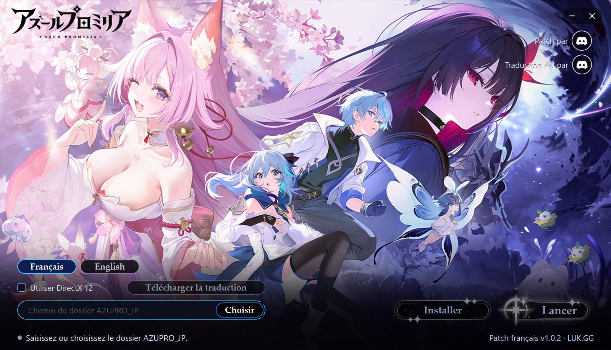

# Azur Promilia en français

Traduction française non officielle du client PC japonais d’Azur Promilia. On traduit depuis le japonais, en s’aidant de l’anglais de [promiliafans/i18n](https://github.com/promiliafans/i18n), dont ce dépôt est un fork.

Ce projet n'est ni affilié à Manjuu ni approuvé par l'éditeur. Un patch de traduction modifie les fichiers du jeu, qui tourne avec l'anti-triche ACE : chacun l'installe à ses risques.

## Jouer en français

1. [Télécharge la dernière version du patcher Windows](https://github.com/pedrokarim/azur-promilia-fr/releases/latest/download/azur-promilia-patcher-windows-x64.zip) et décompresse toute l’archive. Laisse les dossiers à côté de `azur-promilia-patcher.exe`.
2. Ferme le jeu et le launcher officiel, puis ouvre `azur-promilia-patcher.exe`. Si le patcher ne trouve pas le jeu, clique sur « Choisir » et sélectionne le dossier `AZUPRO_JP` qui contient `AzurPromiliaJP.exe`.
3. Sélectionne « Français ». Si le patcher indique qu’une mise à jour est disponible, clique sur « Télécharger la traduction ». Clique ensuite sur « Installer ».
4. Clique sur « Lancer » ou utilise le raccourci « Azur Promilia (français) ». Le launcher officiel peut remettre les fichiers japonais.



Depuis la 1.2.0, le bouton « Mettre à jour le patcher », en haut à gauche, installe les prochaines versions du programme. À partir de la 1.3.0, ce bouton affiche le numéro de la version disponible. « Télécharger la traduction » récupère les derniers textes français.

Le bouton « Actualités », disponible depuis la 1.3.0, affiche les annonces du jeu dans la langue choisie. Le patcher récupère les nouvelles annonces au démarrage et toutes les 15 minutes tant qu’il reste ouvert.

Avant une mise à jour du jeu, ferme-le et clique sur « Désinstaller ». Une fois la mise à jour terminée, referme le jeu et son launcher officiel, puis clique sur « Installer ». Le patcher repère le build le plus récent.

PedroKarim assure la maintenance du patcher français. Pour signaler un problème, rejoins [le Discord Ascencia Realms](https://discord.gg/rTd95UpUEb).

Le launcher se traduit à part, avec [azur-promilia-fr-launcher](https://github.com/pedrokarim/azur-promilia-fr-launcher).

## Organisation

| Fichier | Rôle |
|---|---|
| `strings.translatable.jsonl` | Le japonais et l'anglais de l'amont. On ne le modifie jamais à la main : il se met à jour depuis promiliafans/i18n. |
| `fr/client-3273853.jsonl` | Textes japonais vérifiés sur le build 3273853, en attendant leur arrivée dans l’amont. L’amont prend le relais dès qu’il reprend le texte ou son identifiant. |
| `fr/strings.fr.jsonl` | Le français, une ligne `{"id", "jp", "fr"}` par texte traduit, triée par `id`. |
| `fr/context.md` | L'univers, le personnage du joueur, les personnages et leur registre, les règles d'écriture. À lire avant de traduire. |
| `fr/glossary.tsv` | Noms et termes, avec leur traduction et leur statut (`official`, `client`, `proposed`, `approved`). |
| `AGENTS.md` | Le brief des agents qui traduisent. |
| `fr/orphans.jsonl` | Les traductions dont le japonais a disparu du jeu après une mise à jour. Elles servent de modèle pour retraduire. |
| `scripts/fr.mjs` | L'outil : avancement, vérification, lots de travail, fabrication du fichier du patcher. |
| `fr/static-ui.fr.jsonl` | Les libellés fixes des menus, hors du fichier de traduction : une ligne `{"key", "jp", "en", "fr"}` par entrée de la table `StaticTextConfig` du jeu. |
| `scripts/static-ui.py` | Tire cette table du pack anglais du patcher et refait le pack français. |

Une traduction est rattachée au texte japonais, et non à son `id`. C'est aussi ce que fait le patcher. Quand une mise à jour du jeu change une phrase, seule cette ligne repasse « à traduire » ; tout le reste tient.

## Traduire

Il faut Node 20 ou plus, sans rien installer d'autre.

```sh
node scripts/fr.mjs stats                                  # où on en est
node scripts/fr.mjs todo --limit 200 --max-length 20       # 200 textes courts (menus) à traduire
node scripts/fr.mjs todo --grep "クエスト" --out work/quetes.jsonl
node scripts/fr.mjs import work/quetes.jsonl               # reverse les lignes dont « fr » est rempli
node scripts/fr.mjs check                                  # vérifie tout le français
```

`todo` écrit un fichier de travail dans `work/` (ignoré par git) avec le japonais, l'anglais et un champ `fr` vide. On remplit `fr`, puis `import` vérifie chaque ligne avant de l'ajouter. Options de `todo` : `--limit`, `--grep` (expression cherchée dans le japonais ou l'anglais), `--max-length`, `--src acedy|phist`, `--out`.

Une ligne est refusée si ses variables (`{0}`, `{playerName}`, `%s`…) ou ses balises d'affichage (`<color=…>`, `<b>`, `<actionkey>`, ``…) ne sont pas exactement celles du japonais. Un oubli casserait l'affichage dans le jeu. Les balises `<ruby>`, qui donnent la lecture des kanji, peuvent disparaître.

Les lignes de l'amont peuvent contenir des sauts de ligne (`\n`) : on les garde là où le français coupe naturellement la phrase, sinon le texte déborde des bulles.

## Fabriquer le fichier du patcher

```sh
node scripts/fr.mjs build                    # dist/strings.fr.jsonl : ce qui n'est pas traduit reste en anglais
node scripts/fr.mjs build --fallback jp      # dist/strings.fr-jp.jsonl : ce qui n'est pas traduit reste en japonais
node scripts/fr.mjs build --accent-test      # dist/strings.accent-test.jsonl : quelques menus avec accents, « » et espaces insécables
```

Le fichier produit garde le format de l'amont (`{"id", "jp", "en", "src"}`) : le patcher ne lit que `jp` et `en`, donc le français passe dans `en`. Un `en` vide laisse le texte japonais.

À chaque modification poussée sur `main`, l'action « Publier la traduction » vérifie le français et publie les trois fichiers dans la release [`latest`](../../releases/tag/latest). Le patcher les télécharge depuis cette release.

## Les libellés fixes des menus

Une partie des menus (boutons, onglets, titres d'écran, consignes) ne passe pas par `strings.translatable.jsonl` : le jeu la lit dans la table `StaticTextConfig`, rangée dans un AssetBundle à part. Les fans en ont fait un pack anglais, que le patcher installe. `fr/static-ui.fr.jsonl` en donne la traduction, clé par clé. Le japonais d'origine est chiffré dans le jeu : le champ `jp` ne donne que le japonais retrouvé dans `strings.translatable.jsonl` pour le même anglais, et reste vide sinon. On traduit donc souvent depuis l'anglais, avec le glossaire. Un `fr` vide laisse l'anglais.

Le pack ne se publie pas ici (il contient des fichiers du jeu) : on le refait à partir du pack anglais du patcher, `data/static/yr49bxop0f3reujfsmyfca.r`. Il faut Python 3 et UnityPy, dans un venv :

```sh
python -m venv .venv && .venv/Scripts/pip install UnityPy          # une fois (bin/ au lieu de Scripts/ hors Windows)
python -I scripts/static-ui.py check                                 # variables et balises identiques à l'anglais
python -I scripts/static-ui.py build <patcher>/data/static/yr49bxop0f3reujfsmyfca.r <patcher>/data/static-fr
python -I scripts/static-ui.py extract <pack-anglais.r>             # après une mise à jour du pack anglais : nouvelles clés, français gardé
```

`build` écrit le pack et son `files.txt`, puis relit le résultat : hors des textes de la table, il doit être identique au pack anglais, octet pour octet. Le bundle modifié garde sa place et sa taille dans le fichier, car le jeu le retrouve par sa position ; si le français ne tient plus dans l'emplacement, `build` s'arrête et il faut raccourcir des textes. Comme `fr.mjs build`, il pose les espaces insécables et change « … » en trois points.

## Suivre l'amont

```sh
git fetch upstream
git merge upstream/main
```

Le fichier amont et le français sont séparés, donc la fusion ne crée pas de conflit. Après la fusion, `node scripts/fr.mjs orphans` liste les traductions dont le japonais a changé, et `orphans --move` les range dans `fr/orphans.jsonl`.

## À vérifier avant de traduire en masse

La police du jeu n'a pas encore été testée en français. `build --accent-test` remplace six menus des réglages (Réglages, Langue, Graphismes, Confirmer, Annuler, Retour) par des textes pleins d'accents, de guillemets « » et d'espaces insécables. Si un caractère s'affiche en carré dans le jeu, il faudra s'en passer ou remplacer la police.
